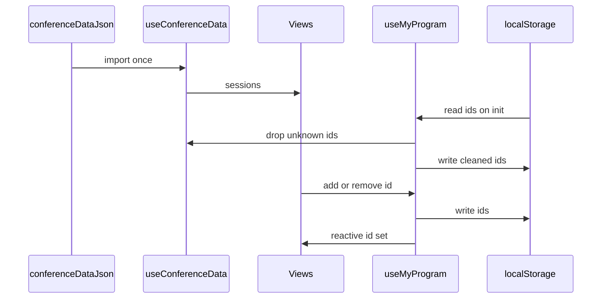

# State-Management: „Mein Programm“ und conference-data.json

## Konzept

Der geteilte Datensatz liegt als statisches Modul unter `src/data/conference-data.json` und wird importiert, nicht per `fetch` geladen. Damit hängt der Funktionsnachweis nicht an einem laufenden API-Server. Das Wurzelobjekt hat fünf Teile: `conference` (Name FrontendNow, Tagline, Daten, Ort Wien, Zeitzone), `tracks` (fünf Einträge mit `id` und `name`), `rooms` (vier Räume mit Kapazität), `speakers` (IDs wie `sp01`, dazu Name, Rolle, Firma, Bio und `sessionIds`) und `sessions` (zwanzig Einträge `s01` bis `s20` mit Titel, Abstract, `trackId`, `speakerIds`, Tag, Uhrzeit, `roomId`, Niveau und Format). Sprecher und Sessions verweisen über IDs aufeinander. Es gibt keine eingebetteten Objekte.

`useConferenceData()` ist ein Modul-Singleton. Der Import passiert einmal, beim ersten Aufruf der Composable, und jede View bekommt dieselben Arrays und dieselben Lookup-Funktionen `sessionById`, `speakerById`, `trackById` und `roomById`. Ein zweites Laden ist unnötig, weil sich die Datei zur Laufzeit nicht ändert. Vue hält die Rückgabe reaktiv, damit spätere abgeleitete Listen, etwa ein Filter in der Programm-View, von denselben Objekten lesen.

„Mein Programm“ speichert nur Session-IDs, zum Beispiel `s01`, unter dem Schlüssel `relay.myProgram.v1` in `localStorage`. Volle Session-Objekte wären ein zweiter Datensatz. Ändert sich Titel oder Raum in der JSON-Datei, bliebe die Kopie in `localStorage` alt. Mit IDs holt sich die Oberfläche Speaker, Track und Raum immer aus `useConferenceData()`. Die Version im Schlüssel erlaubt später ein neues Format, ohne alte Einträge falsch zu lesen.

Geschrieben wird bei jedem `add` und `remove` sofort. Es gibt keinen extra Sync-Zeitpunkt und keinen Server. Beim Start liest `useMyProgram()` die gespeicherten IDs und schneidet sie mit den aktuellen Sessions. IDs, die es in der Datei nicht mehr gibt, fallen weg und werden zurückgeschrieben, damit der Speicher nicht weiter verwaiste Werte hält. Die übrig gebliebenen IDs liegen in einem reaktiven Set. Karte, Detailseite und Dashboard rufen nur `add`, `remove` und `has` auf. Sie teilen sich die eine Instanz, weil auch diese Composable ein Singleton ist. Ein `provide`/`inject` wäre an den Komponentenbaum gebunden. Das Singleton bleibt erreichbar, auch wenn eine spätere Ansicht außerhalb des bisherigen Baums liegt.

Die Startseite zeigt in diesem Schritt nur `sessions.length`, also 20. „Mein Programm“ zeigt die Anzahl der gespeicherten IDs. Die Listen selbst kommen in Schritt 2.

