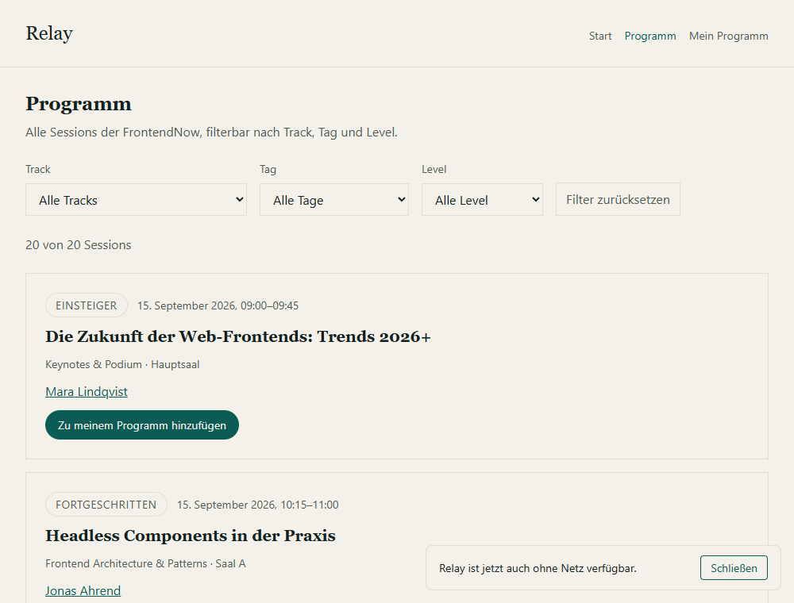
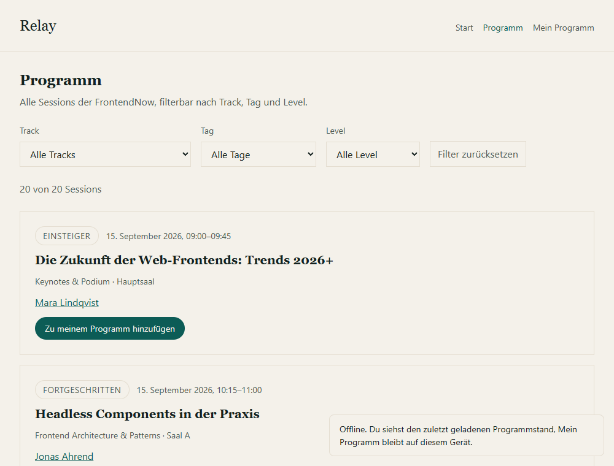
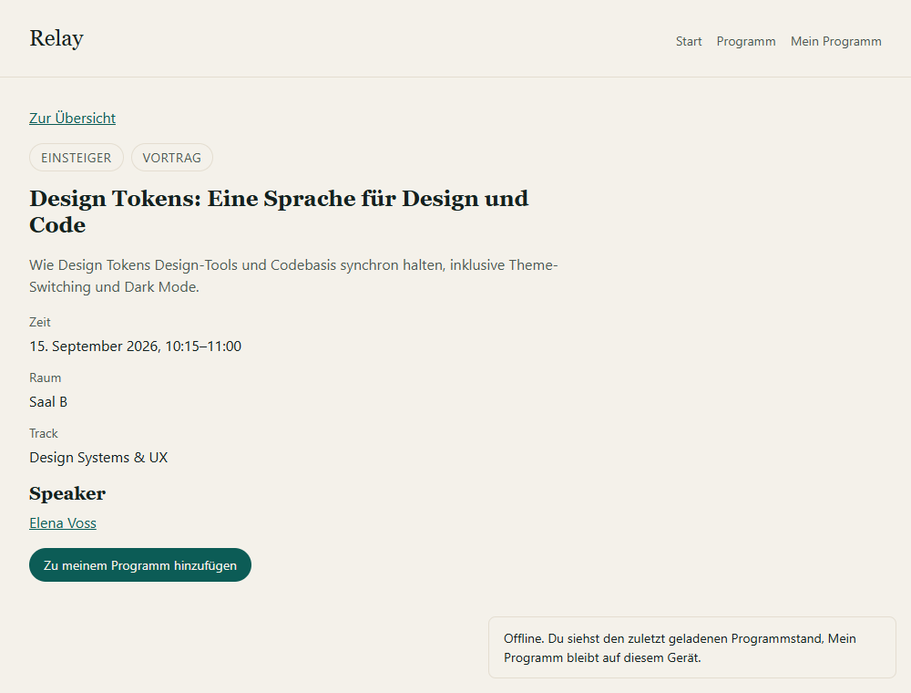
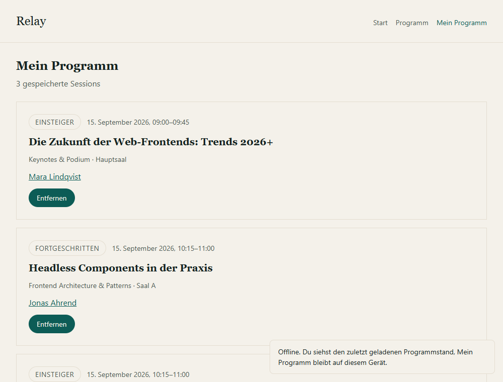
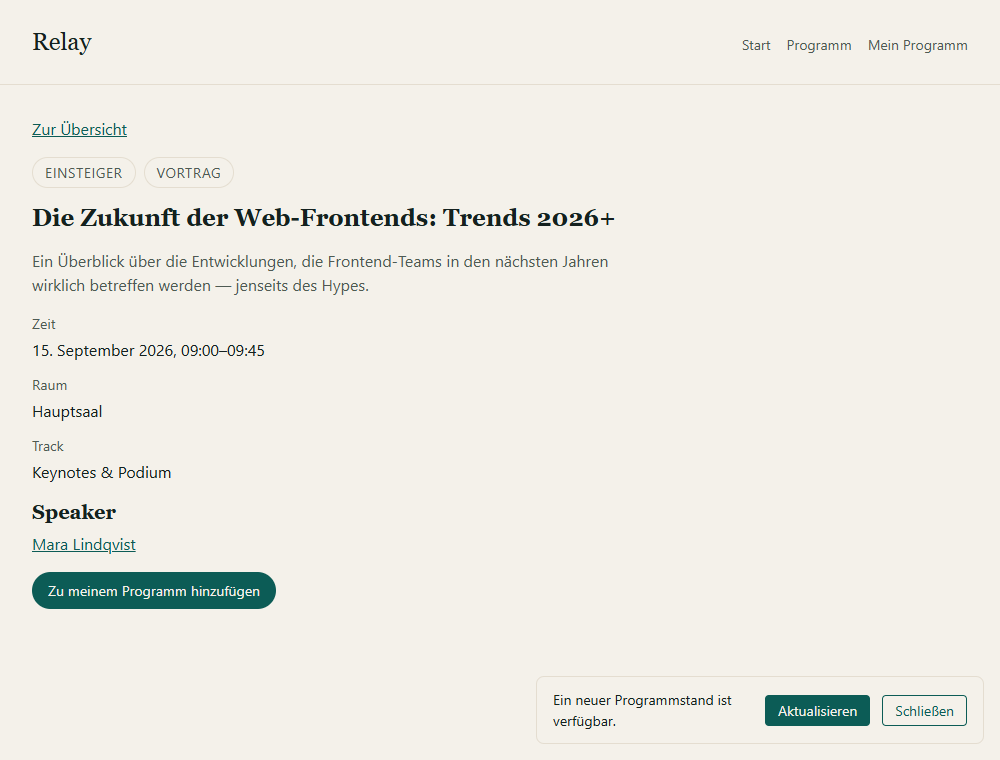
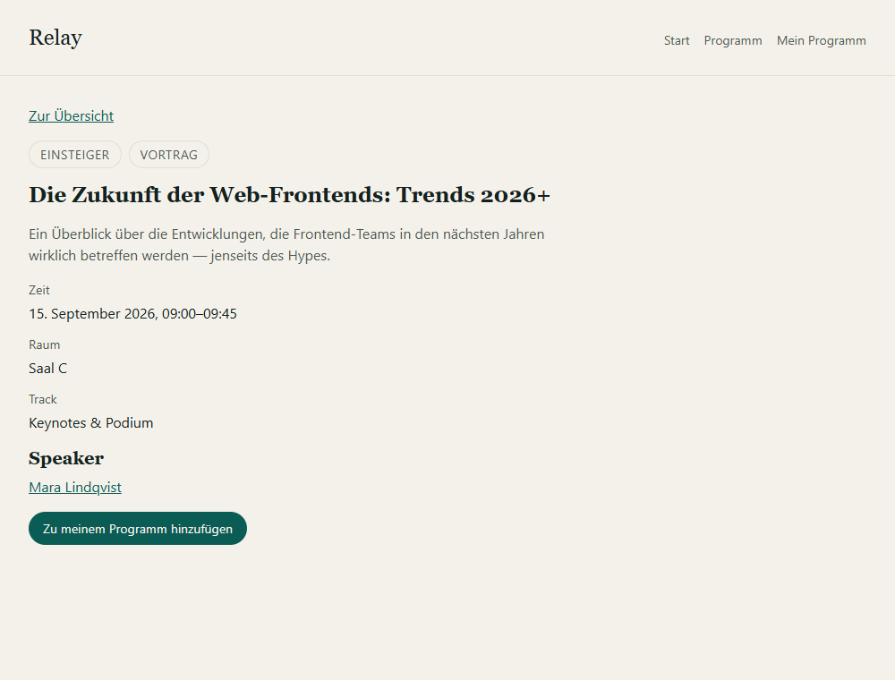
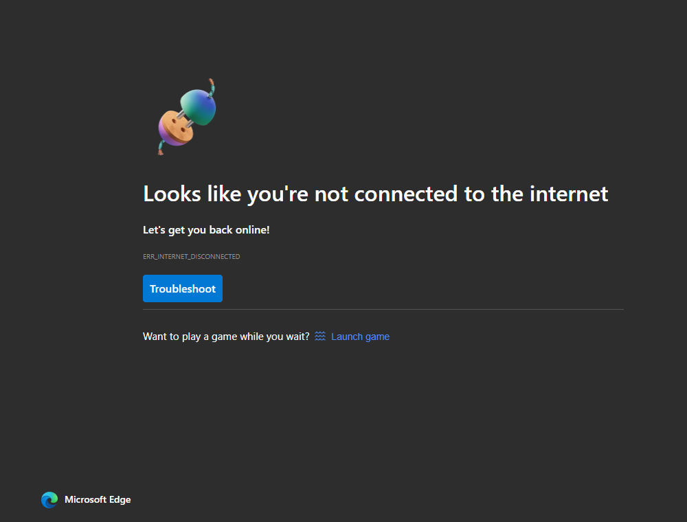
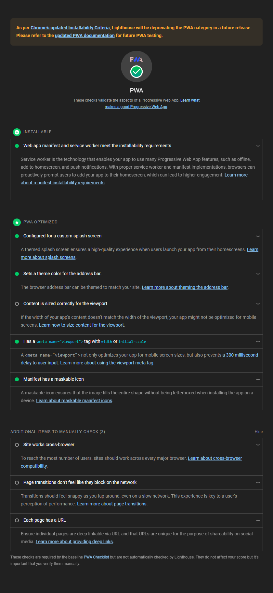

# Verifikations-Nachweis

## Einordnung

Getestet wurde der Production-Build über `vite preview` in Microsoft Edge 157, gesteuert mit Puppeteer über das DevTools-Protokoll. Offline bedeutet die Netzwerkemulation „Offline“, derselbe Schalter wie im Network-Tab, plus einen gestoppten Server. Der HTTP-Cache des Browsers war abgeschaltet, sonst hätte der Speicher-Cache Lücken im Service Worker verdeckt. Das ist in Iteration 3 tatsächlich passiert. Skript und Rohdaten liegen unter [`assets/`](assets/), der Lauf ist also wiederholbar.

Die Szenarien 1 und 2 zeigen, dass Übersicht, Detailseite und Mein Programm nach einem Online-Besuch ohne Netz vollständig erscheinen. Szenario 3 zeigt die erwartete Fehlerseite beim Erstbesuch. Szenario 4 zeigt, dass eine Raumänderung erst nach „Aktualisieren“ ankommt.

Lighthouse hat die PWA-Kategorie ab Version 12 entfernt. Der Audit lief deshalb mit Lighthouse 11.7.1 gegen Edge: PWA bestanden, das Manifest und der Service Worker erfüllen die Installierbarkeit. Offline-Verhalten prüft Lighthouse 11 nicht mehr, das decken die Szenarien ab.

**Lücken:** Getestet wurde nur auf einem Rechner und nur in Chromium. Firefox, Safari auf iOS und eine echte Installation auf einem Telefon fehlen. Es gibt keine Screenshots der DevTools-Oberfläche, weil der Browser headless lief. Die Inhalte des Cache Storage stehen stattdessen im Log.

## Belege je Szenario

| Szenario | Beleg |
| --- | --- |
| 1, online geladen |  |
| 1, offline neu geladen |  |
| 1, Deep Link offline |  |
| 2, Mein Programm offline |  |
| 3, Erstbesuch offline |  |
| 4, Update-Hinweis |  |
| 4, nach „Aktualisieren“ |  |
| Iteration 1 |  |
| Iteration 3 |  |

## Cache Storage nach Szenario 1

Aus [`assets/testlauf-log.txt`](assets/testlauf-log.txt):

```text
relay-programmdaten:
  /assets/conference-data-C6UgLlA7.js
workbox-precache-v2-http://localhost:4173/:
  /manifest.webmanifest, /index.html, /favicon.ico,
  /icons/icon-maskable-512.png, /icons/icon-512.png, /icons/icon-192.png,
  /icons/apple-touch-icon.png, /assets/workbox-window.prod.es5-BBnX5xw4.js,
  /assets/index-gSbg1C7X.css, /assets/index-CBmEiSiX.js
```

## Lighthouse 11.7.1, Kategorie PWA

Vollständiger Bericht: [`assets/lighthouse-report.json`](assets/lighthouse-report.json).


